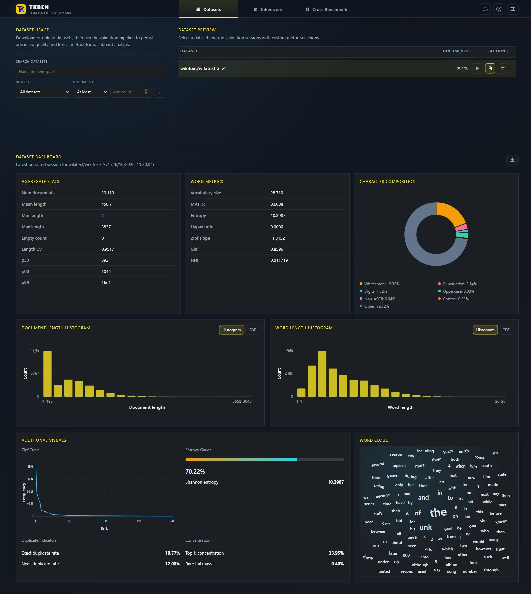
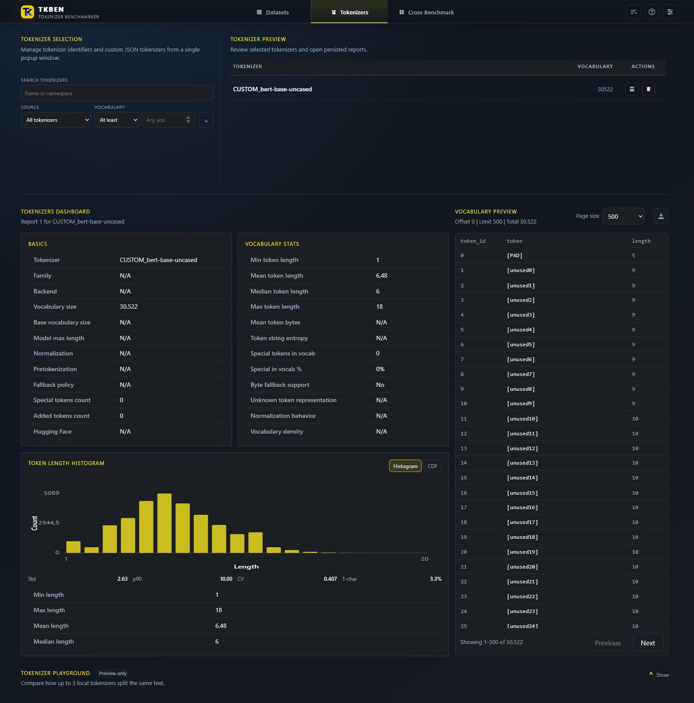

<p align="center"></p>

<h1 align="center">TKBEN Tokenizer Benchmarker</h1>

<p align="center">A local workspace for analyzing text datasets and comparing tokenizers.</p>

<p align="center">
  <a href="https://github.com/CTCycle/TKBEN-tokenizers-benchmarker/stargazers"></a>
  <a href="https://github.com/CTCycle/TKBEN-tokenizers-benchmarker/commits"></a>
</p>

<p align="center">
  <a href="https://github.com/CTCycle/TKBEN-tokenizers-benchmarker/releases"></a>
  <a href="https://github.com/CTCycle/TKBEN-tokenizers-benchmarker/actions/workflows/ci.yml?query=branch%3Adevelop"></a>
  <a href="LICENSE"></a>
</p>

<p align="center">
  <a href="https://www.python.org/"></a>
  <a href="https://angular.dev/"></a>
  <a href="https://www.microsoft.com/windows"></a>
</p>

<p align="center">
  <a href="#dataset-analysis">Dataset analysis</a> ·
  <a href="#tokenizer-reports">Tokenizer reports</a> ·
  <a href="#cross-benchmark">Cross Benchmark</a> ·
  <a href="#configuration">Configuration</a> ·
  <a href="assets/docs/project_index.md">Documentation</a>
</p>

<p align="center"></p>

TKBEN is a local web application for inspecting text datasets, reviewing tokenizer reports, and comparing tokenizers on the same data. The supported launcher runs on Windows and opens the interface in your browser.

| Workflow | What it does |
| --- | --- |
| **Dataset analysis** | Import CSV or XLSX files, add predefined or Hugging Face datasets, and inspect corpus statistics. |
| **Tokenizer reports** | Download or upload tokenizer assets, review vocabulary details, and compare local tokenizers in the playground. |
| **Cross Benchmark** | Compare up to five prepared tokenizers on a saved dataset, review performance and text-fidelity metrics, and export dashboards. |

The Jobs panel tracks concurrent dataset validation, tokenizer-report, and benchmark jobs. You can also filter the dataset and tokenizer catalogs and manage application settings in the interface.

> Benchmark results depend on the dataset, selected metrics, run settings, and machine. Interpret them in that context rather than as a universal tokenizer ranking.

## Get started

On Windows, clone or download the repository and open PowerShell in its root directory:

```powershell
.\start_on_windows.ps1
```

Choose **Launch application**. On first launch, the launcher may download its portable Python, Node.js, and uv runtimes, install dependencies, initialize the database, and build the frontend. It opens the application once the API and frontend are ready. Keep the launcher window open and press **Ctrl+C** there to stop the app.

To start directly without the menu, run `.\start_on_windows.ps1 -Launch`. The launcher serves the Angular frontend and FastAPI API from the same local address. See [startup](assets/docs/runtime/startup.md) for maintenance options and troubleshooting.

## Dataset analysis

In **Datasets**, add a CSV or XLSX file, select a predefined dataset, or download one from Hugging Face. Run validation to inspect document lengths, vocabulary, character composition, and other corpus statistics. Saved analyses can be reopened from the dataset dashboard.

Hugging Face downloads need network access; gated datasets also need suitable credentials.

## Tokenizer reports

In **Tokenizers**, download tokenizer assets or upload a `tokenizer.json` file. Open a report to inspect vocabulary details and token-length statistics, or use the playground to compare how up to three local tokenizers split the same text.

<p align="center"></p>

## Cross Benchmark

Run a benchmark on a saved dataset with up to five prepared tokenizers. Compare performance, vocabulary, and fidelity metrics; saved reports can be reopened, tagged, and compared with a selected baseline.

<p align="center"></p>

To run a comparison:

1. In **Datasets**, add a dataset and run its validation pipeline.
2. In **Tokenizers**, add the tokenizer assets you want to compare and open their reports.
3. In **Cross Benchmark**, choose **Run**, select a saved dataset and tokenizers, and configure the metrics and run settings.
4. Review the dashboard. Saved reports can be reopened, tagged, compared with a baseline, and exported to PDF.

Use the Help button in the application for page-specific guidance.

## Configuration

SQLite is the default database; PostgreSQL can be configured under **Settings → Database**. Dataset and tokenizer artifacts are stored in the configured data directory, which defaults to `data`. **Settings → Storage** controls data and log paths; path changes take effect after a backend restart and do not move existing data. Application settings and dashboard preferences are stored in the active database. Hugging Face keys are managed under **Settings → Keys**.

The launcher creates `settings/.env` from `settings/.env.example` if needed. See [runtime configuration](assets/docs/runtime/configuration.md) for listener settings, storage, and database details.

## Development

The frontend uses Angular and the backend uses Python and FastAPI. For a two-terminal development setup, run the following from the repository root (with Python/uv and Node.js available):

```powershell
# Terminal 1: API
Set-Location app/server
uv sync
uv run python -m uvicorn server.app:app --app-dir .. --reload --host 127.0.0.1 --port 5000
```

```powershell
# Terminal 2: frontend
Set-Location app/client
npm ci
npm run dev -- --host 127.0.0.1 --port 8000
```

Open [http://127.0.0.1:8000](http://127.0.0.1:8000). The development server proxies `/api` to `127.0.0.1:5000` by default; set `FASTAPI_HOST` and `FASTAPI_PORT` in the frontend terminal to use another backend address. The supported test runner is `.\app\tests\run_tests.bat`. See the [documentation index](assets/docs/project_index.md) for architecture, configuration, and testing details.

## Contributing

Issues and focused pull requests are welcome. Describe the problem or change and include relevant validation. The [testing and quality guide](assets/docs/coding/testing_and_quality.md) covers project conventions.

## License

[MIT](LICENSE)
