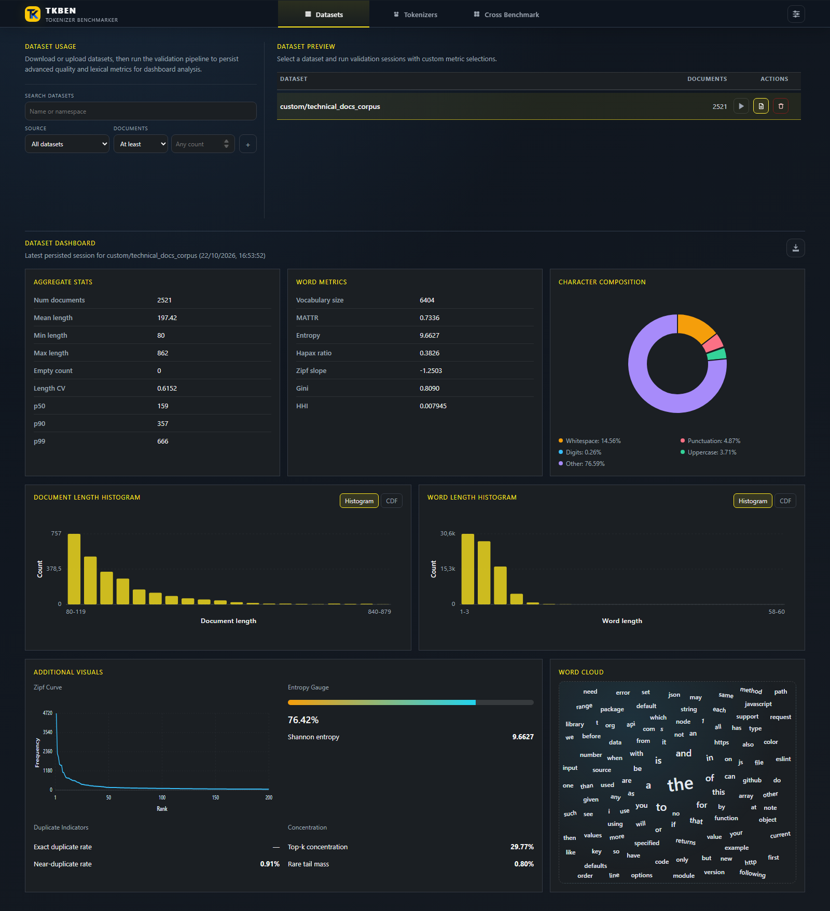
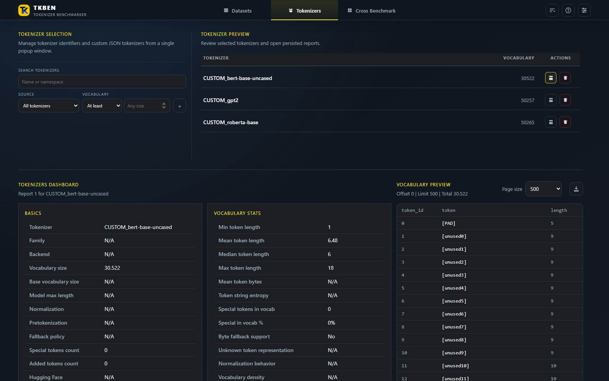
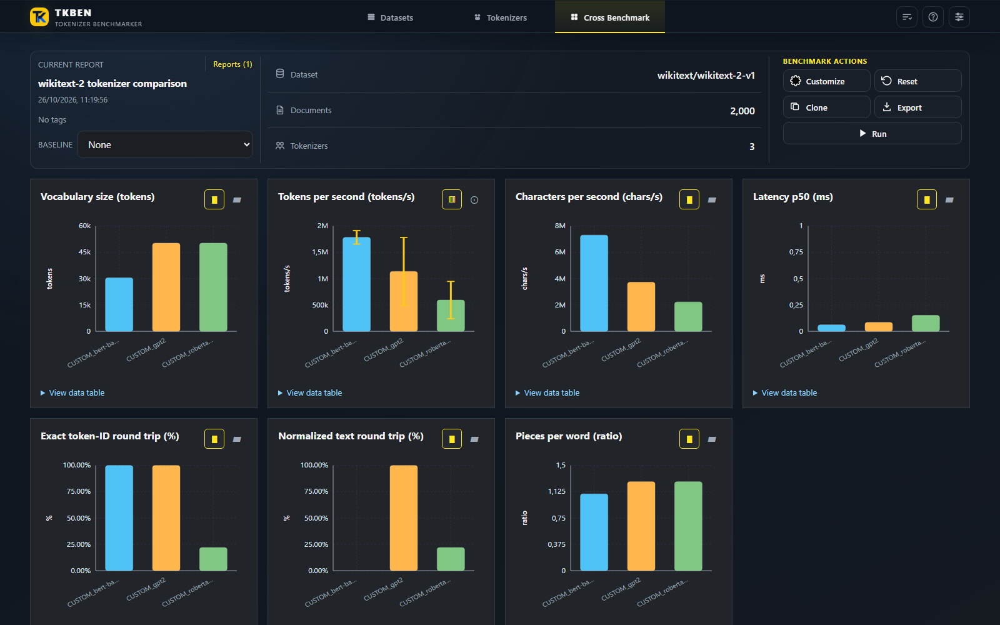

<p align="center"></p>

# TKBEN Tokenizer Benchmarker

**A local workbench for inspecting text datasets, exploring tokenizers, and comparing tokenizer behavior.**

[](https://github.com/CTCycle/TKBEN-tokenizers-benchmarker/stargazers) [](https://github.com/CTCycle/TKBEN-tokenizers-benchmarker/commits) [](https://github.com/CTCycle/TKBEN-tokenizers-benchmarker/releases) [](LICENSE)

[](https://www.python.org/) [](https://angular.dev/) [](https://www.microsoft.com/windows)

## Overview

TKBEN is a local web workbench for inspecting text datasets, exploring tokenizer assets, and comparing how multiple tokenizers process the same saved data. It keeps datasets, tokenizer assets, benchmark reports, and dashboard preferences on the computer running the application, with SQLite as the default database and PostgreSQL available for advanced setups. Tokenizers and datasets can come from local files or optional Hugging Face sources, and each tokenizer can be inspected for vocabulary, token lengths, and special tokens. Benchmarks compare prepared tokenizers on selected performance, vocabulary, and fidelity measures, while saved reports, diagnostics, and PDF export support later review. No single metric identifies the best tokenizer for every task; results depend on the chosen dataset, measures, run settings, and machine.

## Key Features

- Add predefined or Hugging Face datasets, or upload local CSV and XLSX files, then review dataset and lexical statistics.
- Search for tokenizer assets, download them, or upload a custom `tokenizer.json`; inspect vocabulary, token lengths, and special tokens.
- Compare up to five prepared tokenizers on the same saved dataset using selected performance, vocabulary, and fidelity measures.
- Preview how up to three local tokenizers split the same text in the Tokenizer Playground, and run dataset validation, tokenizer reports, and benchmarks concurrently with independent progress in the Jobs panel.
- Review cross-benchmark reports, compare tokenizer metrics against a report-scoped baseline, clone eligible configurations, and edit report tags.
- Save and reopen reports, customize dashboard views, inspect run diagnostics, and export completed reports as PDFs.
- Open the header Help dialog for tips and a guided walkthrough of each page.
- Search, filter, and manage dataset and tokenizer catalogs by source and numeric thresholds.
- Configure, test, and switch SQLite or PostgreSQL connections from Settings -> Database; runtime settings and dashboard preferences save automatically to, and remain scoped to, the active database.

## Screenshots

<p align="center">
  <kbd></kbd>
  <kbd></kbd>
</p>
<p align="center"><sub>Dataset statistics (left) and tokenizer overview (right).</sub></p>

<p align="center">
  <kbd></kbd>
</p>
<p align="center"><sub>Cross-benchmark comparison view.</sub></p>

## Technology Stack

| Layer | Technology | Version |
|---|---|---|
| Backend | Python, FastAPI, uv | 3.14.7 |
| Frontend | Angular | 22 |
| Frontend tooling | Node.js | 22.23.1 |
| Database | SQLite (default), PostgreSQL (optional) | - |
| Optional sources | Hugging Face datasets and tokenizers | - |

## Installation and Usage

The supported Windows workflow uses the repository launcher. From the repository root in PowerShell, run:

```powershell
.\start_on_windows.ps1
```

Choose **Launch application**. The first launch may download portable runtimes and dependencies, prepare the database, and build the web client. FastAPI serves the built Angular SPA and `/api` from the same local origin. The launcher waits for API and frontend readiness, opens that URL, and stays in the console to supervise the app. Press Ctrl+C in that window to stop it cleanly. `-Launch` uses the same supervised lifecycle without showing the maintenance menu.

### Manual development workflow

Development uses two terminals: FastAPI with Uvicorn reload in one, and Angular CLI's development server in the other. The Angular dev server proxies `/api` to FastAPI. From the repository root, use the default local addresses:

Terminal 1:

```powershell
Set-Location app/server
uv sync
uv run python -m uvicorn server.app:app --app-dir .. --reload --host 127.0.0.1 --port 5000
```

Terminal 2:

```powershell
Set-Location app/client
npm ci
npm run dev -- --host 127.0.0.1 --port 8000
```

For another backend address, set `FASTAPI_HOST` and `FASTAPI_PORT` in the frontend terminal before `npm run dev`; the proxy defaults to `127.0.0.1:5000`. `UI_HOST` and `UI_PORT` configure the development server only. The production launcher does not use `npm run preview`.

## Configuration

The launcher creates `settings/.env` from `settings/.env.example` when the file is missing. Use **Settings -> Storage** to choose the data and log directories (default `data` and `data/logs`; applied after a backend restart), **Settings -> Database** to configure and test a SQLite or PostgreSQL connection, **Settings** for application options, and **Settings -> Keys** for Hugging Face access keys. Generate the encryption key there once before adding keys.

| Variable | Purpose | Default |
|---|---|---|
| `FASTAPI_HOST` | Backend host for the frontend proxy | `127.0.0.1` |
| `FASTAPI_PORT` | Backend port for the frontend proxy | `5000` |
| `UI_HOST` | Development server host | `127.0.0.1` |
| `UI_PORT` | Development server port | `8000` |

## Documentation

- [Runtime startup](assets/docs/runtime/startup.md)
- [Runtime configuration](assets/docs/runtime/configuration.md)
- [Release notes and procedure](assets/docs/runtime/release.md)

## Limitations

- No single metric identifies the best tokenizer for every task. Results depend on the chosen dataset, measures, run settings, and machine.
- Data, tokenizer assets, and reports are stored on the computer running the app.
- Hugging Face sources require network access and, for gated assets, valid credentials.
- PostgreSQL is available for advanced setups, but SQLite remains the default.

## Contributing

Contributions are welcome. Open an issue or pull request with a clear description of the change and its motivation. Keep changes focused and consistent with the existing code style.

## License

Licensed under the MIT License. See [LICENSE](LICENSE).
