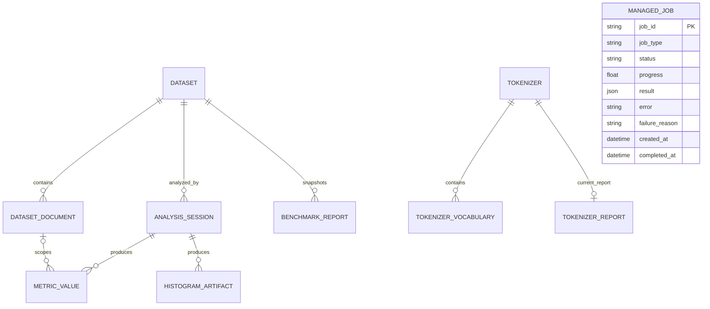

# Persistence
Last updated: 2026-10-21

## Storage selection

The database connection is configured by Settings → Database and persisted
outside the database in `<TKBEN_DATA_DIR>/database-config.json`. This file is
the independent source of truth required to open the selected backend.
`TKBEN_DATA_DIR` remains a bootstrap environment value; SQLite defaults to
`<TKBEN_DATA_DIR>/database.db`. PostgreSQL uses the fixed
`postgresql+psycopg` driver. Database access is injected through the shared
repository backend, which can be replaced after requests drain.

Alembic is the authoritative schema owner. Application startup and the
database-initialization command run the same idempotent migration workflow:
they create a missing SQLite file (or a missing PostgreSQL target when the
configured role has `CREATEDB`), acquire the backend migration lock, upgrade an
empty database to the single repository head, and verify that head in the
protected transaction.
`Base.metadata.create_all()` is not used for production initialization.

SQLite migrations use `BEGIN IMMEDIATE`, bounded by the configured connection
timeout, and run a foreign-key integrity check before
commit. PostgreSQL uses an advisory transaction lock; database creation is
serialized through a separate maintenance-database advisory lock.

Migration failures never activate a partial schema. If the selected database
cannot initialize at process startup, FastAPI starts in a limited repair mode:
health and Database Settings remain available while other database-backed
routes return HTTP 503. A successful runtime switch restores normal service.
Databases ahead of the application, unknown revisions, multiple heads, and
unrecognized or partial unversioned schemas fail without automatic downgrades
or destructive changes.

A non-empty database without an Alembic version row is rejected. Historical
schemas remain represented by the tracked `0001_pre_alembic_schema` and
`0002_current_schema` revisions; the `0003_canonical_state_cleanup` revision
purges incompatible reports and converts persisted metric and tokenizer state
to the current contract, `0004_benchmark_report_tags` adds the relational
report tag array without changing the immutable report payload, and
`0005_managed_job_lifecycle` adds durable managed-job lifecycle records.
Revision `0006_database_runtime_settings` adds the singleton row for sparse
user-editable application settings. Revision `0007_dashboard_ui_preferences`
adds report-dashboard layout, chart, and baseline preferences to that row with
an independent revision counter.

The active database owns all non-database application settings, including
report-dashboard layout, visibility, visualization, and baseline preferences.
Runtime setting values and dashboard preferences have separate revision
counters in the singleton row. Runtime switching first connects to and migrates the candidate, drains in-flight API
requests, and refuses to switch while managed jobs are pending or running. It
then replaces the shared backend and loads that database's settings; a failed
activation retains the prior connection and configuration. Settings are never
copied between databases. A process restart is required only for bootstrap
configuration such as listener addresses, filesystem roots, or encryption
key-material location.

## Canonical tables

The schema contains `dataset`, `dataset_document`, `analysis_session`,
`metric_value`, `histogram_artifact`, `managed_job`, `tokenizer`,
`tokenizer_vocabulary`, `tokenizer_report`, `benchmark_report`,
`application_runtime_settings`, and `hf_access_keys`. The obsolete
`dataset_validation_report` table is removed.

The canonical ownership and cardinalities are:



`HF_ACCESS_KEYS` is intentionally standalone: it stores encrypted provider
credentials and activation state and has no foreign-key relationship to the
feature tables. `METRIC_VALUE.dataset_id` participates in composite foreign
keys with `(session_id, dataset_id) -> ANALYSIS_SESSION` and
`(document_id, dataset_id) -> DATASET_DOCUMENT`; `document_id` is nullable for
aggregate values. The diagram shows the logical relationships without
duplicating every composite key column.

Datasets are imported as `loading` records and become visible only after all
documents are inserted and the row is finalized as `ready`. Documents have a
dataset-local ordinal and the ready document count is stored on `dataset`.
Failed or cancelled loading imports attempt to delete the loading row, and
database cascades remove their documents when that deletion commits. If storage
pressure also prevents cleanup from committing, the failure is logged and the
incomplete row may remain until storage is available for cleanup.

Metric values carry the owning dataset, store the canonical metric key directly,
enforce composite session/document ownership, require exactly one value
representation, and use partial unique indexes for aggregate and per-document
values. Tokenizer rows declare `source` as `huggingface` or `custom`; custom
rows require a durable canonical `tokenizer.json` artifact. Tokenizer reports
are current-only: replacing a report replaces its vocabulary and report as one
logical operation. Vocabulary shape metrics remain in the existing report JSON
(`metadata.vocabulary_stats` and `token_length_histogram`), so no relational
migration is needed for those values. Benchmark reports keep immutable
schema-3/report-5 detail
JSON plus projected summary columns and a non-null relational `tags` JSON array;
list queries project tags without selecting the full payload. Reports from older
contracts are purged by migration and incompatible rows fail explicitly if
encountered later; dashboard histogram bins remain inside the immutable detail
payload.

Benchmark report snapshots store tokenizer names in JSON because the report is
an immutable run record; there is no benchmark-report/tokenizer junction table.
The `tokenizer_report` uniqueness rule makes the persisted tokenizer report
current-only, while `benchmark_report` preserves historical run snapshots.

Report deletion removes the `benchmark_report` row physically in one repository
transaction. There is no soft-delete record or compatibility tombstone;
subsequent list and load queries no longer return the deleted report, including
after restart.

## Persistence ownership

Persistence ownership follows the repository/service split:

- `repositories/datasets.py` owns dataset and analysis materialization and is
  represented by `DatasetRepository`.
- `repositories/tokenizer_reports.py` owns tokenizer report and vocabulary
  persistence and is represented by `TokenizerReportRepository`.
- `repositories/jobs.py` owns durable job lifecycle records and is represented
  by `JobRepository`; `JobManager` coordinates runner state and writes through
  that repository.
- `repositories/runtime_settings.py` owns the singleton settings persistence row;
  it stores sparse runtime overrides and dashboard UI preferences in the
  selected database.
- `services/benchmark_reports.py` owns benchmark report persistence
  orchestration through `BenchmarkReportService`.
- The report service uses the benchmark repository/database boundary for
  transactions and summary/payload queries.

Repositories and services use the current schema and response contracts without
compatibility aliases or implicit row creation. Managed jobs are independent
of feature-table rows; their result payload is retained with the job record.

At application startup, `JobManager` restores retained job rows after Alembic
initialization. Pending or running rows are terminalized as `failed` with an
application-restart error and an internal `failure_reason`; the public job API
keeps its existing response shape. Completed, failed, and cancelled results
remain queryable until terminal-job retention prunes them. No runner is
automatically restarted.

## Runtime database switching

The file-based database configuration is loaded before database initialization.
At runtime, the Database Settings API checks the target connection and brings
its schema to the current Alembic head before the shared database backend is
replaced. Ordinary API requests drain first. Switching returns HTTP 409 while
managed jobs are pending or running; otherwise repositories and the job manager
are rebound to the target, and application settings are loaded from that target.
The browser performs a full reload to clear feature-store caches. No records or
settings are copied between databases. If activation fails, the previous
connection and file configuration remain active. Network listener changes and
other bootstrap-only environment settings still require a restart.

## Backend and transaction guarantees

SQLite enables foreign keys at connection time. SQLite and PostgreSQL share the
same repository transaction behavior: bounded inserts and upserts commit once
per logical operation and roll back the whole operation on error. Hugging Face
key activation is atomic and the database permits at most one active key.
SQLite serializes writes; PostgreSQL is required for concurrent writer
validation.

Timestamps are normalized to aware UTC values at the persistence boundary.
JSON object and array fields are validated by typed SQLAlchemy decorators;
contract validation remains responsible for nested JSON contracts and
histogram array compatibility.

## Validation

The SQLite persistence contract covers schema creation, foreign keys, lifecycle
visibility, composite ownership, partial uniqueness, value-shape constraints,
cascades, rollback, active-key uniqueness, keyset document streaming, and
upgrade from `0004_benchmark_report_tags` with managed-job persistence. Restart
reconciliation and result/error retention are covered by the managed-job
service and API tests. Controlled SQLite `SQLITE_FULL` validation confirms that
failed custom-upload and Hugging Face dataset persistence imports clean up their
partial rows and can be retried after storage capacity returns; it does not
simulate exhaustion of the host filesystem. The current ledger records this as
PARTIAL validation debt.

PostgreSQL integration was subsequently validated against isolated PostgreSQL
18.6 clusters: concurrent initialization, migration to `0005` and then `0006`,
authenticated UI connection testing, runtime switching, independent settings,
restart recovery, and injected-failure rollback/retry passed. The existing host
listener was not contacted, so the evidence does not claim general deployment
equivalence.
See the [project status ledger](../project_status_ledger.md) for the current
gate and historical migration-failure reconciliation.

## Migration workflow

From `app/server`, use the existing project environment with the TOML
configuration loaded explicitly:

```powershell
uv run python -c 'from alembic.config import Config; from alembic import command; command.current(Config(toml_file="pyproject.toml"), check_heads=True)'
uv run python -c 'from alembic.config import Config; from alembic import command; command.upgrade(Config(toml_file="pyproject.toml"), "head")'
uv run python -c 'from alembic.config import Config; from alembic import command; command.check(Config(toml_file="pyproject.toml"))'
uv run python -c 'from alembic.config import Config; from alembic import command; command.revision(Config(toml_file="pyproject.toml"), message="<change>", autogenerate=True)'
```

Review every generated revision manually; the tracked
`migrations/script.py.mako` file is the single revision-generation template,
not application runtime configuration. Alembic uses the pyproject
configuration and the application settings loader; no `alembic.ini` is
maintained. Database credentials are read from the independent
`database-config.json` file, not from `.env` or the active database.
Use the application initializer (launcher option 4 or
`app/scripts/initialize_database.py`) for an existing database. A non-empty
unversioned database is intentionally a hard failure and must be restored from a
versioned backup or recreated.

The current repository head is `0007_dashboard_ui_preferences`. Managed-job rows,
ready dataset rows, tokenizer rows, reports, and canonical tokenizer artifacts
are stored under the configured data root and are retained across
application restarts unless explicitly deleted. Dataset files and tokenizer
artifacts are persistent application data under
`<TKBEN_DATA_DIR>/sources/datasets` and
`<TKBEN_DATA_DIR>/sources/tokenizers`; they are not part of the disposable
`runtimes/cache` hierarchy and are not removed by cache cleanup.
